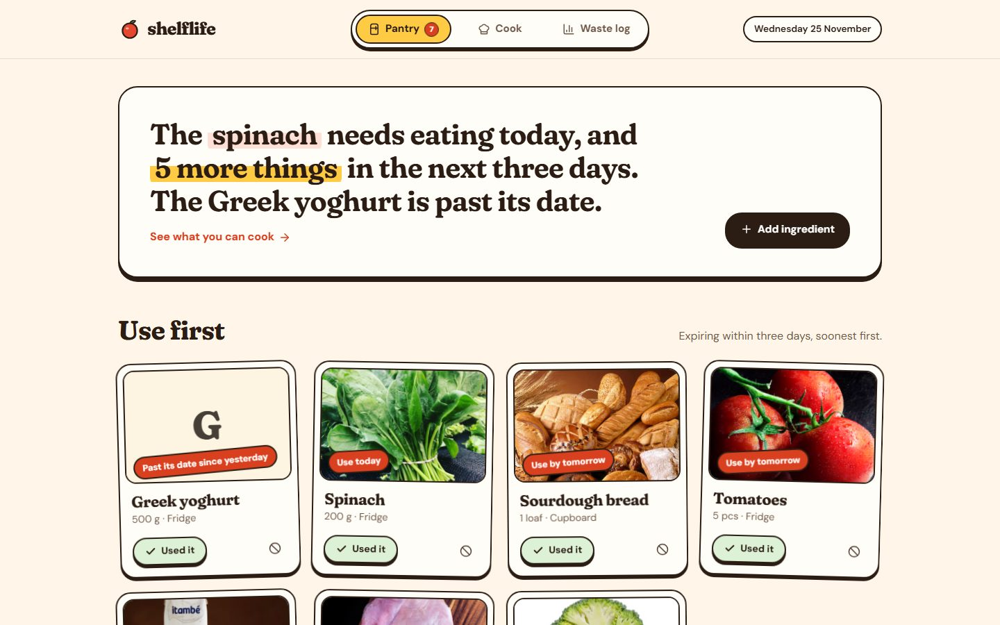

# ShelfLife

**Eat what you have, before it turns.** ShelfLife keeps track of your fridge and cupboards,
warns you before food expires, suggests what to cook with it, and shows how much you
actually used versus threw away.

> Live demo: [shelflife-brown-three.vercel.app](https://shelflife-brown-three.vercel.app) · Part of [my portfolio](https://ilia-rusia.vercel.app)



## Features

- **Pantry dashboard** with a written daily note ("The spinach needs eating today…")
- **"Use first"** spread for everything expiring within three days
- **Add, edit and delete** ingredients in an accessible native `<dialog>` with validation
- **Freshness bars** and colour-coded expiry labels, including items already past their date
- **Search**, **category filters** and sorting (soonest, A–Z, recently added)
- **Mark as used** or **thrown away**, with a six-second **undo**
- **Recipe suggestions** from a local dataset, ranked by how many ingredients you have and
  how much expiring food each recipe rescues. "I cooked this" uses up the ticked ingredients.
- **Waste log**: monthly used-in-time rate with a trend, money wasted, a week-by-week chart,
  waste by category and a logbook
- Everything persists in `localStorage`

## How recipe matching works

`src/utils/recipes.js` scores each recipe:

```
score = coverage × 10 + rescued items × 3 − missing items × 2
```

`coverage` is the share of key ingredients in stock. A rescued item is one that expires
within three days. Expired items are never suggested as usable.

## Built with

React 19 · Vite · `useReducer` + custom hooks (`usePantry`, `useHashTab`, `useFlip`) · native `<dialog>` ·
plain CSS · Lucide icons · food photography from Unsplash

## Motion

ShelfLife uses real spring physics without a library. A CSS `linear()` easing curve overshoots
and settles like a spring, so buttons sink into their shadow and bounce back, the tab highlight
springs between sections, and charts bounce up. The ingredient list uses a hand-written **FLIP**
hook (`src/hooks/useFlip.js`) on the Web Animations API: used items squash and fly out, and the
rest of the list glides into place.

## Project structure

```
src/
  components/   Masthead, ItemDialog, RecipeDialog, Thumb, UndoToast
  data/         catalog.js (categories, photos, recipes), seed.js (sample pantry + history)
  hooks/        usePantry (reducer, persistence, undo), useHashTab (#pantry/#cook/#insights)
  utils/        dates.js (local dates, freshness), recipes.js (matching)
  views/        Pantry, Cook, Insights
```

## Run locally

```bash
npm install
npm run dev        # http://localhost:5176
```

## Build & deploy

```bash
npm run build      # outputs to dist/
npm run preview
```

Import the repository on [Vercel](https://vercel.com). No extra configuration is needed:
views use the URL hash, so there are no server routes.

---

ShelfLife is a portfolio concept. The sample data is generated relative to today's date, so
there is always something to rescue.
